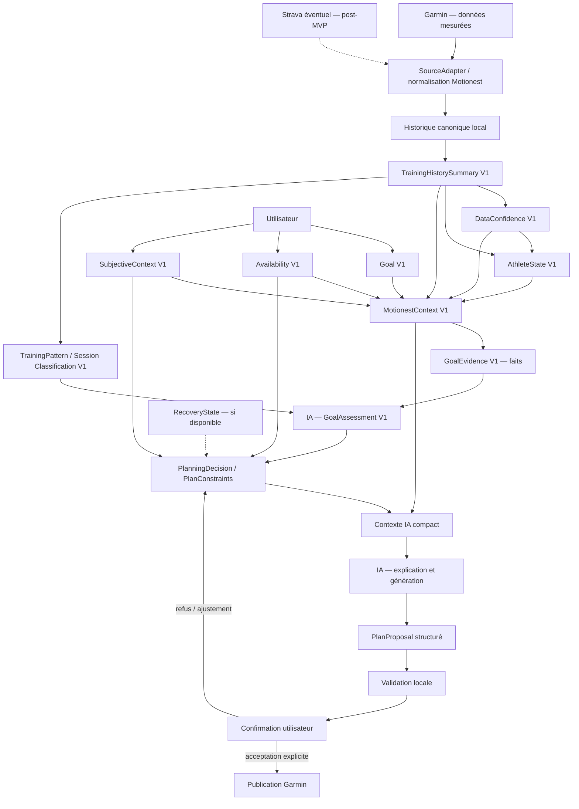

# Motionest — document maître produit et technique

> Référence principale du projet à partir du commit `9c6972e` (`fix: allow limited history through context`).
>
> État vérifié dans le dépôt le 1er octobre 2026. Ce document décrit à la fois ce qui existe réellement et la cible. Lorsqu'il contredit un ancien plan, il prévaut, mais ne remplace ni un contrat de données versionné ni une décision métier validée ultérieurement.

## 1. Vision et limites de responsabilité

Motionest transforme des données sportives mesurées, des intentions utilisateur et des contraintes explicites en décisions de coaching traçables, puis en plans proposés à l'utilisateur. Le produit doit rester utile avec beaucoup, peu ou aucune donnée sportive et ne doit jamais faire passer une hypothèse pour une mesure.

| Responsable | Rôle |
| --- | --- |
| Garmin / source sportive | Fournir les données mesurées et historiques disponibles : activités, métriques et, plus tard, données Health/Recovery. |
| Motionest | Isoler, importer, assainir, normaliser, résumer, calculer et comparer de façon déterministe; évaluer la confiance et les contraintes; orchestrer les étapes. |
| IA | Interpréter et juger la difficulté/faisabilité de l'objectif, expliquer ce jugement, puis générer et adapter un plan à partir d'un contexte structuré et de contraintes bornées. |
| Utilisateur | Déclarer son intention, ses disponibilités futures et son contexte subjectif; corriger ses déclarations; accepter ou refuser les décisions et publications. |

Principes non négociables :

- ne pas envoyer des années d'activités brutes à un fournisseur IA;
- ne jamais inventer de Recovery, de performance, d'expérience ou de capacité lorsque les données sont absentes;
- distinguer explicitement `mesuré`, `déclaré`, `déduit`, `recommandé` et `confirmé`;
- préférer les métriques Garmin natives lorsqu'elles existent et exposer leur couverture;
- ne pas sacrifier la qualité, la complétude ou la reprise de l'import pour quelques secondes gagnées;
- minimiser les données conservées, affichées, journalisées et envoyées à l'IA;
- isoler les comptes, espaces locaux, tokens et tâches par utilisateur;
- aucune publication Garmin avant acceptation explicite du plan par l'utilisateur;
- une absence de données sportives limite une conclusion sportive, mais ne rend pas automatiquement un contrat technique inutilisable.

## 2. État réel du dépôt au commit de référence

### 2.1 Inventaire confirmé

| Composant | État réel | Preuves principales | Limite actuelle |
| --- | --- | --- | --- |
| Compte Motionest | DONE | `user_accounts.py`, routes `/api/account/*`, `landing.html` | Stockage JSON local; pas de suppression/export; pas de limitation distribuée. |
| Vérification e-mail | DONE localement | token aléatoire haché, expiration 24 h, usage unique, renvoi, SMTP ou outbox locale | Fournisseur SMTP et identité expéditeur à configurer en production. |
| Sessions | PARTIAL | cookie signé HMAC, 8 h ou 30 jours, HttpOnly, SameSite=Strict, Secure en production | Pas de registre/révocation serveur ni rotation globale; hardening production incomplet. |
| Routage première utilisation | PARTIAL | `determine_user_stage()`, login et gardes `/dashboard`/`/connect-garmin` | Pas encore appliqué uniformément à toutes les routes/actions sensibles. |
| Connexion Garmin liée au compte | DONE pour le flux actuel | `/connect-garmin`, `/api/garmin/connect`, contexte utilisateur, tokens par utilisateur, MFA | API Garmin non officielle; secrets stockés en fichiers JSON non chiffrés au repos. |
| Import historique paginé | DONE | scopes 3 m/6 m/1 a/2 a/all, page 250 configurable, cutoff, fin réelle, checkpoints | Validation réelle dépend de Garmin et de sa stabilité. |
| Reprise/checkpoint | DONE | état atomique par utilisateur, détection d'import stale, ancres de reprise | Outils opératoires de migration/réparation encore absents. |
| Détails multisport | DONE | planification dynamique de 7 endpoints, états par endpoint, tous sports conservés | Pertinence fondée sur signaux observables; couverture Garmin variable. |
| Pipeline concurrent borné | DONE | 3 workers par défaut, plage 1–5, capacité bornée, clients/sessions distincts | Tuning réel Garmin à conserver prudemment; streaming a une file producteur de taille 1. |
| Gestion 429 | DONE dans l'import | contrôleur global, Retry-After, pause, réduction de concurrence, compteurs | Ne couvre pas nécessairement toutes les autres routes Garmin legacy. |
| Historique local unifié | DONE | multisport prioritaire, fallback legacy contrôlé, détails paresseux, scope figé | Le reste de l'application consomme encore partiellement l'ancien stockage. |
| TrainingHistorySummary V1 | DONE comme contrat | agrégats compacts, fenêtres 28/84 jours/historique, multisport, tendances, preuves | Construit à la demande par l'orchestrateur runtime; les autres flux legacy ne le consomment pas encore. |
| DataConfidence V1 | DONE comme contrat | confiance par composant, données manquantes/stale/warnings, Recovery indisponible explicite | Construit à la demande par l'orchestrateur runtime; les prompts legacy restent exclus. |
| AthleteState V1 | DONE comme contrat | état factuel, capacité et limites, sans prédiction ni Recovery inventée | Construit à la demande par l'orchestrateur runtime. |
| Goal V1 | DONE comme contrat | intentions `progress`, `race`, `beginner`, `comeback`, validation stricte, adaptateur legacy | L'UI persiste encore `objective` legacy. |
| Availability V1 | DONE comme contrat | jours, préférence de fréquence, jours de sortie longue, date d'effet, adaptateur legacy | L'UI persiste encore `availableDays`/`sessionsPerWeek`. |
| SubjectiveContext V1 | DONE comme contrat | douleur explicite/unknown, préférences, activités non enregistrées, adaptateur legacy | L'UI actuelle ne collecte pas tout le contrat minimal cible. |
| MotionestContext V1 | DONE comme contrat | intégration compacte et déterministe, blocages techniques vs limitations sportives | Construit sur `GET /api/onboarding`; non transmis aux prompts legacy. |
| GoalEvidence V1 | DONE comme contrat runtime | faits déterministes pour l'objectif, preuves/confiance/échéance et comparaison Riegel route | Ne juge pas la faisabilité; le futur GoalAssessment V1 sera produit par l'IA. |
| Génération et publication legacy | PARTIAL / LEGACY | `training_cycle.py`, `garmin_workouts.py`, acceptation de proposition | N'utilise pas MotionestContext V1, GoalEvidence/GoalAssessment ni PlanConstraints V2. |
| Dashboard actuel | PARTIAL / LEGACY | activités, objectif, plan, coach, détails, actions | Mélange stockage legacy et cible; ce n'est pas le dashboard final. |
| Strava | DEFERRED / LEGACY | import manuel d'un export CSV de courses | Pas d'API/OAuth, pas de SourceAdapter canonique, pas de déduplication multisource. |
| Recovery/Health | TODO | absence explicitement représentée dans DataConfidence/AthleteState | Aucun import Garmin Health et aucun RecoveryState. |

### 2.2 Ce que « DONE » signifie ici

`DONE comme contrat` signifie : schéma V1 strict, constructeur déterministe, sortie compacte et tests dédiés. Depuis l'orchestration runtime, les contrats sont construits à la demande par le point réel `/api/onboarding`. Ils ne pilotent pas encore l'onboarding V2, le futur GoalAssessment IA, les prompts de plan ou la génération de plan.

### 2.3 Tests au point de référence

- Baseline annoncée et confirmée avant cette tâche : **513 tests réussis**, **0 échec**, **4 warnings externes `garminconnect`**.
- La revue de robustesse ajoute des scénarios d'autorité V1, fingerprint, concurrence et remplacement atomique. Exécution monolithique sur la branche : **527 réussis, 1 échec**, le seul échec étant `test_logout_endpoints_expire_only_the_expected_session_cookie` sur `WinError 10053`; ce test réussit isolément (**1 réussi**) et le problème est déjà reproductible sur `main`. Aucun code d'authentification n'a été modifié pour le masquer. Les **4 warnings externes `garminconnect`** restent inchangés.
- Le nombre seul n'est pas une preuve suffisante : chaque scénario métier critique doit avoir un test explicite à la bonne couche.

## 3. Parcours utilisateur cible A → Z

1. Création du compte Motionest.
2. Vérification de l'adresse e-mail.
3. Connexion Motionest et détermination serveur de l'étape courante.
4. Onboarding minimal : intention, disponibilité et contexte subjectif utile.
5. Choix de connexion des données.
6. Connexion Garmin rattachée au compte Motionest.
7. Choix du scope historique si nécessaire.
8. Import paginé, détails multisport, reprise et progression visible.
9. Analyse locale déterministe.
10. Écran « Voilà ce que Motionest a compris de toi ».
11. Construction déterministe des preuves liées à l'objectif (`GoalEvidence`).
12. Évaluation expliquée de l'objectif par l'IA (`GoalAssessment`).
13. Proposition de fréquence.
14. Confirmation ou ajustement utilisateur de la fréquence.
15. Génération d'une proposition de plan bornée par des contraintes structurées.
16. Présentation du plan et de ses limites.
17. Explication claire de la proposition.
18. Acceptation ou refus explicite.
19. Publication Garmin uniquement après acceptation.
20. Dashboard opérationnel.
21. Import et analyse factuelle des entraînements futurs.
22. Adaptation hebdomadaire, avec confirmation selon l'impact.
23. Modification de l'objectif ou des disponibilités et recalcul des décisions dépendantes.
24. Fin de cycle, nouvelle course ou nouveau cycle.

Garmin n'est jamais une identité Motionest. Une reconnexion Garmin ne réinitialise jamais l'onboarding. Une déconnexion de source ne doit pas supprimer implicitement l'historique Motionest sans choix explicite.

## 4. Vue globale d'avancement

### TERMINÉ

- [x] Import Garmin paginé, scopes, cutoff et reprise/checkpoint.
- [x] Détails multisport, planification dynamique des endpoints et persistance atomique.
- [x] Pipeline concurrent borné et gestion globale des 429 pour les détails.
- [x] Lecteur d'historique local unifié avec fallback legacy contrôlé.
- [x] TrainingHistorySummary V1, DataConfidence V1 et AthleteState V1.
- [x] Goal V1, Availability V1 et SubjectiveContext V1.
- [x] MotionestContext V1 avec distinction blocage technique/limitation sportive.
- [x] Orchestration runtime V1 appelée par `/api/onboarding`, avec migration legacy idempotente.
- [x] GoalEvidence V1 déterministe, exposé comme champ frère du contexte runtime.

### EN COURS / PARTIEL

- [~] Fondations compte, e-mail et session : fonctionnelles localement, durcissement production incomplet.
- [~] Parcours utilisateur : décision centralisée et gardes principales présentes, protection non généralisée.
- [~] Publication Garmin : acceptation et idempotence legacy présentes, contrat V2 absent.
- [~] Dashboard et coaching : produit legacy fonctionnel, non branché aux contrats V1.

### À FAIRE

- [x] TrainingPatternEvidence V1 : faits de structure des séances et compétitions passées explicitement identifiables, branchés au runtime local.
- [x] AI Goal Assessment V1 : interprétation structurée, groundée et explicitement déclenchée depuis les faits V1.
- [ ] Fréquence recommandée, confirmation et PlanConstraints.
- [ ] Onboarding V2 et écran de compréhension.
- [ ] Contrat IA V2, PlanProposal V2 et validation locale.
- [ ] Adaptation V2, dashboard final et production hardening.

### PLUS TARD

- [ ] Recovery/Health si hors promesse du premier MVP.
- [ ] Statistiques et records avancés.
- [ ] API Strava, autres sources et déduplication multisource.
- [ ] Fonctionnalités sociales et calendriers avancés.

| Domaine | Statut | Commentaire |
| --- | --- | --- |
| Fondations compte et e-mail | DONE | Fonctionnelles localement; hardening production séparé. |
| Parcours et connexion Garmin | PARTIAL | Flux principal présent, gardes non généralisées. |
| Import historique multisport | DONE | Pagination, détails, reprise, concurrence et 429 couverts. |
| Compréhension déterministe athlète | DONE | Summary, confiance et AthleteState disponibles comme contrats. |
| Contrats utilisateur | DONE | Goal, Availability et SubjectiveContext disponibles comme contrats. |
| Intégration du contexte | DONE | MotionestContext V1 existe comme contrat pur. |
| Intégration runtime des contrats V1 | DONE | Construction locale à la demande via `/api/onboarding`; déclarations V1 versionnées et migration legacy idempotente. |
| GoalEvidence | DONE | Contrat V1 pur, faits versionnés et intégration runtime `/api/onboarding`; aucun verdict sportif. |
| TrainingPatternEvidence V1 | DONE | Contrat compact, déterministe et runtime : intervalles structurés explicites, longue sortie relative, course explicite, intensité agrégée, provenance et limites. |
| AI Goal Assessment | DONE | Input compact, prompt versionné, sortie Pydantic, supporting facts whitelistés, cache fingerprinté et endpoints GET/POST séparés. |
| Fréquence recommandée / décision | TODO | Dépend du futur GoalAssessment. |
| Onboarding V2 | TODO | Doit persister les contrats V1 et les confirmations. |
| Écran de compréhension | TODO | Dépend de l'orchestration des contrats. |
| Contrat IA V2 et plan V2 | TODO | Le flux IA/plan actuel est legacy. |
| Validation locale du plan | TODO | Contraintes structurées et vérification nécessaires. |
| Publication Garmin V2 | PARTIAL | Publication/acceptation existent, mais sont liées au plan legacy. |
| Recovery/Health | TODO | Absence correctement déclarée aujourd'hui. |
| Adaptation hebdomadaire V2 | TODO | Un cycle legacy existe, pas la cible contractuelle. |
| Dashboard V2 cible | TODO | `dashboard_v2.html` est une UI existante, pas l'architecture cible complète. |
| Statistiques/records | DEFERRED | Post-MVP. |
| Multi-source/Strava | DEFERRED | Import CSV legacy seulement; étude R&D séparée. |
| Production hardening | TODO | Sécurité, conformité, stockage, observabilité, migrations et exploitation. |

## 5. Architecture cible

Règles de dépendance :

- `DataConfidence` qualifie ce que le résumé permet d'affirmer; il ne remplace pas les faits.
- `AthleteState` décrit l'athlète à partir des faits et de leur confiance; il ne juge pas l'objectif.
- `MotionestContext` vérifie que les contrats peuvent circuler ensemble; il ne recommande pas de plan.
- `GoalEvidence` calcule, structure et compare les faits; il ne juge jamais l'objectif.
- le futur `GoalAssessment` est produit par l'IA pour interpréter la difficulté/faisabilité, expliquer le jugement et exposer son incertitude.
- `PlanningDecision` distingue jours disponibles, préférence, recommandation puis confirmation.
- l'IA intervient après les décisions déterministes et ne peut contourner leurs contraintes.

## 6. Roadmap par phases

L'ordre proposé est conservé avec deux précisions : l'intégration runtime des contrats V1 est explicitée avant la refonte UI, et Recovery reste après le MVP initial tant que son absence est représentée sans invention.

### Phase 0 — Fondations compte, e-mail, parcours et Garmin

**STATUS : PARTIAL**

**OBJECTIF**

Fournir une identité Motionest indépendante, une session et une connexion Garmin isolée par utilisateur.

**ENTRÉES**

Adresse e-mail, mot de passe, acceptation des conditions, vérification humaine, session Motionest, identifiants/MFA Garmin.

**SORTIES**

Compte vérifié, session signée, étape utilisateur, tokens Garmin propres à l'utilisateur et setup initial lancé.

**DÉPENDANCES**

Aucune phase métier antérieure.

**RÈGLES MÉTIER**

Compte Motionest distinct de Garmin; e-mail vérifié avant accès; tokens Garmin isolés; aucune remise à zéro d'onboarding à la reconnexion; comportement sûr sur données corrompues.

**CE QUI EXISTE DÉJÀ**

Inscription, scrypt, unicité e-mail, vérification et reset à usage unique, cookies signés, remember 30 jours, `determine_user_stage()`, page Garmin dédiée, MFA, setup asynchrone et gardes partielles.

**CE QUI RESTE À FAIRE**

Généraliser l'autorisation métier route par route; ajouter révocation/rotation de session, limitation de débit, CSRF adapté, chiffrement des tokens au repos, suppression/export de compte et configuration production.

**TESTS REQUIS**

E2E inscription→vérification→login; expiration/révocation; accès direct à chaque route; brute force; CSRF; isolation; MFA; reset; corruption; suppression/export.

**CRITÈRE DE FIN**

Tout accès sensible est autorisé côté serveur, les secrets sont protégés au repos et le parcours fonctionne en environnement de production testable.

**NE PAS FAIRE À CETTE ÉTAPE**

Mélanger l'identité Garmin au compte Motionest ou confier l'autorisation au frontend.

### Phase 1 — Historique sportif et import multisport

**STATUS : DONE**

**OBJECTIF**

Importer fidèlement l'historique demandé, tous sports, avec détails pertinents, reprise et limites de charge.

**ENTRÉES**

Session Garmin, scope figé, date de référence et réponses des endpoints de lecture.

**SORTIES**

Métadonnées assainies, états de détails par endpoint et état d'import atomique par utilisateur.

**DÉPENDANCES**

Phase 0.

**RÈGLES MÉTIER**

Pagination jusqu'au cutoff ou à la fin Garmin; tous sports conservés; endpoint appelé seulement s'il est pertinent; 404 terminal `unsupported`; 429 globalement régulé; reprise sans répéter les succès; écritures séquentielles/atomiques.

**CE QUI EXISTE DÉJÀ**

Scopes 3 m/6 m/1 a/2 a/all, page initiale 250 configurable, checkpoints, 3 workers configurables 1–5, file bornée, clients distincts, sept endpoints dynamiques, sanitization GPS/identité/secrets.

**CE QUI RESTE À FAIRE**

Seulement maintenance, mesures réelles périodiques et adaptation prudente aux changements de l'API Garmin.

**TESTS REQUIS**

Pagination, cutoff, reprise, doublons, tous sports, endpoints, erreurs, 429, auth, timeouts, concurrence 1/3/4/5, atomicité, confidentialité et isolation.

**CRITÈRE DE FIN**

Atteint pour V1 : mêmes résultats fonctionnels quelle que soit la concurrence, reprise déterministe et aucun mélange utilisateur.

**NE PAS FAIRE À CETTE ÉTAPE**

Réduire arbitrairement le volume importé, déduire le sport depuis le seul nom ou ajouter des endpoints non pertinents.

### Phase 2 — Compréhension déterministe de l'athlète

**STATUS : DONE**

**OBJECTIF**

Transformer l'historique canonique en faits compacts, confiance explicable et état athlète sans coaching.

**ENTRÉES**

Historique local assaini dans le scope figé et détails à la demande.

**SORTIES**

`TrainingHistorySummary V1`, `DataConfidence V1`, `AthleteState V1`.

**DÉPENDANCES**

Phase 1.

**RÈGLES MÉTIER**

Calcul local déterministe; absence distincte de zéro; couverture par métrique; preuves Garmin explicites; aucune prédiction de performance, expérience, tolérance de charge ou Recovery inventée.

**CE QUI EXISTE DÉJÀ**

Fenêtres 28/84 jours/historique, sports, volume, fréquence, sorties longues, intensité, tendances, interruptions d'enregistrement, performance evidence, confiance et limites.

**CE QUI RESTE À FAIRE**

Brancher ces sorties dans l'orchestration runtime; ne pas modifier leurs responsabilités lors de cette intégration.

**TESTS REQUIS**

Historique vide/court/riche, multisport, données partielles, 5 000 activités, déterminisme, confidentialité, aucun réseau/IA et isolation.

**CRITÈRE DE FIN**

Contrats V1 stables, compacts, testés et utilisables sans historique brut.

**NE PAS FAIRE À CETTE ÉTAPE**

Évaluer la faisabilité d'un objectif ou recommander une fréquence.

### Phase 3 — Contrats utilisateur V1

**STATUS : DONE**

**OBJECTIF**

Séparer les déclarations utilisateur des faits sportifs.

**ENTRÉES**

Intention, course éventuelle, disponibilités, douleur/blessure, préférences et activité non enregistrée.

**SORTIES**

`Goal V1`, `Availability V1`, `SubjectiveContext V1` stricts et adaptateurs legacy diagnostiqués.

**DÉPENDANCES**

Aucune dépendance aux données Garmin.

**RÈGLES MÉTIER**

Quatre intentions; jours disponibles distincts de la fréquence préférée; douleur `unknown` distincte de `explicit_no`; activités non enregistrées marquées `user_reported`.

**CE QUI EXISTE DÉJÀ**

Schémas, builders, validations, sorties IA compactes et adaptateurs depuis `objective` legacy.

**CE QUI RESTE À FAIRE**

Les persister comme source de vérité et les collecter via Onboarding V2.

**TESTS REQUIS**

Valeurs limites, dates, formats de course, jours, incohérences, douleur, préférences, provenance déclarative, diagnostics legacy et déterminisme.

**CRITÈRE DE FIN**

Contrats V1 stables et indépendants de l'UI ou de Garmin.

**NE PAS FAIRE À CETTE ÉTAPE**

Inférer des réponses utilisateur depuis Garmin ou recommander un plan.

### Phase 4 — Intégration MotionestContext V1

**STATUS : DONE**

**OBJECTIF**

Déterminer si les contrats sont techniquement cohérents et assez structurés pour la couche suivante.

**ENTRÉES**

Goal, Availability, SubjectiveContext, AthleteState, TrainingHistorySummary et DataConfidence.

**SORTIES**

`MotionestContext V1`, statut d'intégration, blocages, limitations, sécurité et fréquence déclarée/observée.

**DÉPENDANCES**

Phases 2 et 3.

**RÈGLES MÉTIER**

Contrat absent/incohérent = blocage; preuve sportive faible = limitation transmissible. `beginner` et `comeback` ne sont pas bloqués par un historique faible; `progress` et `race` exposent `insufficient_training_evidence`.

**CE QUI EXISTE DÉJÀ**

Builder pur, sortie compacte IA, contrôles de dates et de cohérence, statuts `ready`, `ready_with_limitations`, `partial`, `insufficient`.

**CE QUI RESTE À FAIRE**

GoalEvidence et les futures couches IA/décision peuvent consommer ce contexte runtime. Les prompts et la génération legacy restent volontairement inchangés.

**TESTS REQUIS**

Chaque intention, historique vide/faible/riche, Recovery absent, douleur, contradictions techniques, déterminisme, performance et confidentialité.

**CRITÈRE DE FIN**

Atteint pour le contrat V1 et son utilisation par l'orchestrateur runtime; aucune responsabilité de faisabilité ou de planification n'a été ajoutée.

**NE PAS FAIRE À CETTE ÉTAPE**

Juger la faisabilité, conseiller une fréquence ou générer un plan.

### Phase 5 — Orchestration runtime des contrats V1

**STATUS : DONE**

**OBJECTIF**

Construire les sept contrats V1 dans le vrai parcours, avec source de vérité, version et recalcul explicites.

**ENTRÉES**

Historique canonique, réponses V1 persistées et date de référence.

**SORTIES**

Un `MotionestContext V1` reproductible disponible pour l'UI et les décisions suivantes.

**DÉPENDANCES**

Phases 1 à 4.

**RÈGLES MÉTIER**

Ordre déterministe; aucune lecture réseau/IA; invalidation quand historique, Goal, Availability ou SubjectiveContext change; diagnostics legacy visibles pendant migration.

**CE QUI EXISTE DÉJÀ**

`build_runtime_motionest_context(user_id)` relit les déclarations et l'historique local, aligne tous les builders sur la référence figée de l'import (ou une date explicite), puis construit Summary → DataConfidence → AthleteState → MotionestContext. `motionest_inputs_v1.json` persiste Goal, Availability et SubjectiveContext dans l'espace utilisateur avec schéma strict et remplacement atomique. La migration depuis `profile.json.objective` est idempotente, conserve le fichier legacy, expose ses diagnostics et suit son empreinte pour recalculer après modification. Un store portant `source: v1` est toujours prioritaire et n'est jamais réécrit depuis le legacy. La décision lecture/comparaison/écriture est sérialisée pour deux requêtes concurrentes. Le dashboard appelle réellement cette orchestration via `GET /api/onboarding`.

**CE QUI RESTE À FAIRE**

Onboarding V2 devra écrire directement les contrats avec `save_motionest_inputs_v1()` puis retirer progressivement le writer legacy. L'écriture déclenchée aujourd'hui par `GET /api/onboarding` est uniquement un bridge de migration legacy temporaire; elle disparaîtra avec ce writer V2. La construction reste volontairement à la demande et non mise en cache : mesurer son coût en production avant d'introduire un cache avec empreinte d'entrées.

**TESTS REQUIS**

Intégration de bout en bout des builders, changement d'entrée, corruption, isolation, performance, redémarrage et non-régression legacy.

**CRITÈRE DE FIN**

Atteint : le contexte réel est construit sur un point runtime utilisé, sans fixture, Garmin, IA, publication ni persistance d'un contexte calculé susceptible de devenir périmé.

**NE PAS FAIRE À CETTE ÉTAPE**

Changer l'onboarding visuel, juger l'objectif ou appeler l'IA.

### Phase 6 — Goal Evidence / Goal Assessment Context

**STATUS : DONE**

**OBJECTIF**

Calculer et structurer les faits nécessaires à une future évaluation expliquée de l'objectif.

**ENTRÉES**

Goal, AthleteState, TrainingHistorySummary, DataConfidence, date de référence et temps jusqu'à la course.

**SORTIES**

`GoalEvidenceV1`, contrat versionné avec uniquement les statuts de disponibilité `available`, `partial`, `insufficient_data` et `not_applicable`; scope, comparaison factuelle, preuves et limites.

**DÉPENDANCES**

Phase 5.

**RÈGLES MÉTIER**

Calculer l'échéance, sélectionner les preuves structurées et exposer volume, fréquence, longues sorties, interruptions, confiance et données manquantes. Riegel reste une comparaison factuelle pour les distances route standards. Aucun seuil ne classe l'objectif comme soutenu, ambitieux, réaliste ou non soutenu.

**CE QUI EXISTE DÉJÀ**

`goal_evidence.py` définit le contrat strict et `build_goal_evidence_v1()`. Le builder consomme uniquement Goal V1, AthleteState, TrainingHistorySummary, DataConfidence et une date explicite. Il sélectionne une référence par récence, confiance, proximité de distance puis départage stable. Pour les courses route standards uniquement, Riegel V1 (`1.06`) calcule une équivalence et l'écart à la cible, jamais un verdict. Le wrapper runtime expose `goal_evidence` à côté de `context` via `GET /api/onboarding`, sans modifier le contrat MotionestContext V1.

**CE QUI RESTE À FAIRE**

Le futur AI Goal Assessment devra consommer ces faits et produire séparément un `GoalAssessmentV1` expliqué. Trail/custom restent sans extrapolation route; une course sans date conserve `days_to_event: null`; Recovery reste indisponible et non reconstruit.

**TESTS REQUIS**

Couverture dédiée : les quatre intentions, historique vide/faible/riche, 5 km/10 km/semi/marathon, trail/custom, sans date/chrono, date passée/présente, preuves absentes/anciennes/multiples, choix de référence, Riegel, écarts bruts, confiance, longues sorties, interruptions, confidentialité, performance et absence d'I/O/IA.

**CRITÈRE DE FIN**

Atteint : chaque fait est reproductible, qualifié par la confiance disponible et réellement construit dans le parcours runtime, sans verdict sportif.

**NE PAS FAIRE À CETTE ÉTAPE**

Juger la faisabilité, recommander une fréquence, générer des séances ou appeler l'IA.

### Phase 6 bis — TrainingPatternEvidence V1

**STATUS : DONE**

**OBJECTIF**

Exposer factuellement les types de séances réellement observables et les compétitions passées réellement identifiables, sans mélanger cette responsabilité avec GoalEvidence.

**SORTIES CIBLES**

`TrainingPatternEvidenceV1` expose des agrégats 28/84 jours pour `structured_intervals`, `relative_long_run`, `race`, la couverture des sessions ayant au moins un pattern observé, les faits d'intensité existants et `PastRaceEvidence` uniquement lorsqu'un type d'événement Garmin explicite est présent. Les patterns ne sont pas exclusifs : une session portant plusieurs patterns ne compte qu'une fois dans `pattern_coverage`. Chaque résultat conserve provenance, confiance et limitations.

La règle reste volontairement conservatrice : variation d'allure ou de fréquence cardiaque, nom, record personnel, fastest split et distance standard ne produisent aucun label d'intention. `easy`, `recovery`, `tempo`, `threshold` et `progression` ne sont pas déduits en V1.

Le builder pur reçoit des faits session sans identifiant. Le collecteur lit seulement l'historique local unifié et les détails déjà persistés ; aucun appel Garmin, réseau ou IA. Le runtime expose le contrat comme frère de `context` et `goal_evidence`, sans modifier `MotionestContextV1`.

Le contrat distingue la couverture du champ Garmin `eventType`, les valeurs informatives et les signaux explicites `race`/`competition`. `uncategorized` indique uniquement que le champ a été inspecté : il ne constitue ni une preuve de course ni une preuve fiable d'absence de course. TrainingPattern est recalculé à la demande. Le scan des fichiers de détails historiques doit être mesuré sur des historiques plus importants avant toute optimisation ou mise en cache.

**PREUVES**

Tests dédiés : historique vide, sans running ou sans détails, typed splits, effort/récupération répétés, longue sortie relative, faux signaux de course, course explicite, intensité présente/absente, multisport, non-classifié, provenance, confiance, déterminisme, confidentialité, absence d'I/O externe et performance.

**NE PAS FAIRE DANS GOALEVIDENCE**

Déduire ou classer des séances, détecter des courses passées ou modifier une PerformanceEvidence.

### Phase 6 ter — AI Goal Assessment

**STATUS : DONE**

**OBJECTIF**

Interpréter `GoalEvidenceV1` avec l'IA et produire un jugement sportif expliqué sans recalculer ni altérer les faits Motionest.

**ENTRÉES**

GoalEvidence V1, TrainingPatternEvidence V1 et le contexte Motionest minimal utile déjà structuré.

**SORTIES**

`GoalAssessmentV1` structuré : scope, assessment, confiance, résumé, explication, supporting facts, incertitudes et réserves.

**DÉPENDANCES**

Phases 6 et 6 bis. L'appel est explicite via `POST /api/goal-assessment`; `GET` lit seulement le cache et `/api/onboarding` reste local.

**RÈGLES MÉTIER**

L'IA interprète et explique; elle ne modifie pas les preuves, ne fabrique pas de chrono et rend l'incertitude visible. La sortie est validée localement, notamment le scope et chaque path de supporting fact.

**PREUVES**

Le payload exclut les activités brutes et textes libres sensibles. Le fingerprint couvre les faits, les versions et le contenu réel du prompt via son digest; le store utilisateur est atomique et ne persiste ni le payload ni le prompt. Les objectifs non-race retournent localement `not_applicable` sans appel IA. Les erreurs provider ne produisent aucun verdict de secours. Les tests mockés couvrent scopes, grounding, cache, invalidation, concurrence, isolation et confidentialité. La protection anti-double génération est ciblée par store utilisateur et reste mono-processus ; un déploiement multi-processus devra utiliser une coordination partagée.

Cette brique ne marque pas le contrat IA V2 général comme terminé : elle couvre uniquement la frontière GoalAssessment.

### Phase 7 — Fréquence recommandée et PlanningDecision

**STATUS : TODO**

**OBJECTIF**

Proposer une fréquence compatible avec l'objectif, l'état athlète et la disponibilité, puis obtenir une confirmation.

**ENTRÉES**

Availability, AthleteState, Goal, SubjectiveContext, DataConfidence et futur GoalAssessment.

**SORTIES**

`recommended_sessions_per_week`, raisons/limites, `confirmed_sessions_per_week` après choix utilisateur, puis `PlanConstraints`.

**DÉPENDANCES**

Phases 6, 6 bis et 6 ter.

**RÈGLES MÉTIER**

`available_days ≠ preferred_sessions ≠ recommended_sessions ≠ confirmed_sessions`. La recommandation ne dépasse pas les jours disponibles. La valeur confirmée est la seule contrainte de génération.

**CE QUI EXISTE DÉJÀ**

Availability V1, fréquence observée dans AthleteState/MotionestContext et `sessionsPerWeek` legacy.

**CE QUI RESTE À FAIRE**

Contrat de recommandation, règles déterministes, confirmation persistée, gestion d'ajustement et construction de PlanConstraints.

**TESTS REQUIS**

1–7 jours, préférence absente ou supérieure, beginner, comeback, douleur, faible confiance, changement de disponibilité et confirmation différente.

**CRITÈRE DE FIN**

Une fréquence expliquée est proposée et aucune génération ne démarre sans valeur confirmée.

**NE PAS FAIRE À CETTE ÉTAPE**

Créer le calendrier détaillé ou assimiler disponibilité à recommandation.

### Phase 8 — Onboarding V2 minimal

**STATUS : TODO**

**OBJECTIF**

Collecter uniquement ce que Garmin ne peut pas connaître et persister les contrats V1.

**ENTRÉES**

Réponses utilisateur.

**SORTIES**

Goal V1, Availability V1, SubjectiveContext V1, progression reprenable et fin d'onboarding fiable.

**DÉPENDANCES**

Phases 3, 5 et 7 pour le flux complet; la collecte peut être développée avant l'affichage de recommandation.

**RÈGLES MÉTIER**

Question 1 : intention `progress`, `race`, `beginner`, `comeback`. Si `race` : type/distance, date si connue, chrono si souhaité. Puis jours généralement disponibles. Puis douleur/blessure oui/non et courte description si oui. Facultatif : activité importante non enregistrée et préférence majeure.

Ne pas demander niveau, kilométrage, records, allure habituelle, VO2max, sports visibles dans Garmin ni texte objectif libre obligatoire.

**CE QUI EXISTE DÉJÀ**

Dialogue onboarding en trois étapes et endpoint `/api/profile`; validations legacy; contrats/adaptateurs V1; routage de reprise par `onboarding.json`.

**CE QUI RESTE À FAIRE**

Refondre les questions, persister les contrats versionnés, enregistrer chaque étape, reprendre après interruption, migrer les réponses legacy et séparer collecte de la recommandation.

**TESTS REQUIS**

Quatre intentions, champs conditionnels race, reprise à chaque étape, validation serveur, changement de réponse, douleur, activité non enregistrée, migration et mobile.

**CRITÈRE DE FIN**

Un utilisateur peut interrompre/reprendre et produit trois contrats valides sans question redondante avec Garmin.

**NE PAS FAIRE À CETTE ÉTAPE**

Générer le plan, publier Garmin ou demander à l'utilisateur d'autoévaluer des métriques mesurables.

### Phase 9 — Écran « Voilà ce que Motionest a compris de toi »

**STATUS : TODO**

**OBJECTIF**

Rendre les faits, déclarations, limites et décisions contrôlables avant génération.

**ENTRÉES**

MotionestContext, GoalEvidence, futur GoalAssessment, recommandation de fréquence et RecoveryState si réellement disponible.

**SORTIES**

Résumé lisible et actions de correction des informations déclarées.

**DÉPENDANCES**

Phases 5 à 8.

**RÈGLES MÉTIER**

Afficher objectif, activité actuelle, sports, références utiles, évolution récente, disponibilités, fréquence proposée, données manquantes importantes, douleur déclarée et Recovery disponible. L'utilisateur corrige ses déclarations, pas les mesures Garmin.

**CE QUI EXISTE DÉJÀ**

Sorties compactes V1 et résumé Garmin legacy affiché dans l'onboarding.

**CE QUI RESTE À FAIRE**

View-model avec provenance, UI accessible, navigation de correction, recalcul et confirmation.

**TESTS REQUIS**

Riche/vide, quatre intentions, multisport, douleur, champs manquants, provenance, correction et confidentialité.

**CRITÈRE DE FIN**

L'utilisateur comprend ce qui est connu, inconnu ou déclaré et peut corriger sans altérer Garmin.

**NE PAS FAIRE À CETTE ÉTAPE**

Afficher des identifiants techniques, coordonnées GPS ou verdict sans explication.

### Phase 10 — Contrat IA V2 et prompt

**STATUS : TODO**

**OBJECTIF**

Définir une frontière stable et minimale entre décisions Motionest et génération IA.

**ENTRÉES**

MotionestContext, GoalEvidence, futur GoalAssessment et PlanConstraints compactés.

**SORTIES**

Payload IA versionné, schéma de réponse, prompt et politique d'erreur.

**DÉPENDANCES**

Phases 6 et 7.

**RÈGLES MÉTIER**

Credentials backend uniquement; données compactes; aucune clé dans frontend/logs/profil/dépôt. L'IA interprète GoalEvidence, explique, génère, adapte et formule; elle ne recalcule pas les métriques, n'invente rien et ne modifie pas les disponibilités.

**CE QUI EXISTE DÉJÀ**

Provider compatible OpenAI, validation JSON structurée, routage de modèle, suivi d'usage et fonctions `*_for_ai`; prompts legacy.

**CE QUI RESTE À FAIRE**

Schéma V2, minimisation, redaction, budgets, timeouts/retries, version de prompt, validation stricte et tests mockés.

**TESTS REQUIS**

Snapshots de payload, absence PII/GPS/secrets/brut, réponses invalides, timeout, quota, refus, prompt injection dans champs utilisateur et déterminisme de prétraitement.

**CRITÈRE DE FIN**

Le fournisseur reçoit seulement le contexte nécessaire et toute réponse est validée avant usage.

**NE PAS FAIRE À CETTE ÉTAPE**

Appeler l'IA avec `historique_recent` brut ou exposer une clé au navigateur.

### Phase 11 — Génération initiale et validation locale du plan

**STATUS : TODO**

**OBJECTIF**

Produire une proposition structurée conforme aux décisions déterministes.

**ENTRÉES**

Goal, Availability confirmée, SubjectiveContext, AthleteState, DataConfidence, GoalEvidence, futur GoalAssessment, PlanConstraints et RecoveryState si disponible.

**SORTIES**

`PlanProposal` versionnée, validation locale et explication.

**DÉPENDANCES**

Phases 7 et 10.

**RÈGLES MÉTIER**

Valider nombre de séances, jours permis, dates, types, structure et conflits. L'IA ne peut placer une séance un jour interdit. Une sortie invalide n'est ni enregistrée comme acceptée ni publiée.

**CE QUI EXISTE DÉJÀ**

Modèles `InitialPlan`/`PlannedSession`, génération structurée legacy et placement selon jours legacy.

**CE QUI RESTE À FAIRE**

Contrat V2, moteur de validation, erreurs réparables, explications et remplacement du contexte legacy.

**TESTS REQUIS**

Jours, fréquence, dates, doublons, course cible, beginner, douleur, réponse IA invalide, quota, conflits et reproductibilité des validations.

**CRITÈRE DE FIN**

Toute proposition visible passe les validateurs locaux et est traçable à ses entrées/version.

**NE PAS FAIRE À CETTE ÉTAPE**

Publier automatiquement ou corriger silencieusement une sortie dangereuse.

### Phase 12 — Acceptation utilisateur et publication Garmin

**STATUS : PARTIAL**

**OBJECTIF**

Faire de l'acceptation explicite la seule porte vers Garmin.

**ENTRÉES**

PlanProposal validée et décision accept/refuse/revise.

**SORTIES**

Décision auditée, workouts Garmin publiés de façon idempotente ou retour en révision.

**DÉPENDANCES**

Phase 11.

**RÈGLES MÉTIER**

Aucune publication avant acceptation; refus sans effet distant; idempotence; erreur partielle visible et reprenable; vérifier que le plan accepté est celui publié.

**CE QUI EXISTE DÉJÀ**

État `plan_proposed`, endpoint de décision, `publication_allowed`, publication idempotente testée et refus conservant l'état.

**CE QUI RESTE À FAIRE**

Relier le mécanisme au contrat V2, ajouter identifiant/version de proposition, journal d'audit et reprise de publication partielle.

**TESTS REQUIS**

Acceptation, refus, révision, double clic, plan obsolète, panne partielle, reconnexion, idempotence et aucun appel avant acceptation.

**CRITÈRE DE FIN**

Une preuve locale relie proposition, acceptation et objets Garmin créés; aucune autre route ne contourne la règle.

**NE PAS FAIRE À CETTE ÉTAPE**

Considérer la simple génération ou consultation comme une acceptation.

### Phase 13 — Health, Recovery et RecoveryState

**STATUS : TODO**

**OBJECTIF**

Utiliser prudemment les signaux physiologiques Garmin lorsqu'ils existent.

**ENTRÉES**

Training Readiness, Recovery Time, HRV, Sleep, Body Battery et Stress disponibles selon appareil/compte.

**SORTIES**

Import dédié, résumé, confiance et `RecoveryState` pouvant être `unavailable`.

**DÉPENDANCES**

Import/source isolé et DataConfidence; non bloquant pour le MVP initial.

**RÈGLES MÉTIER**

Préférer les données Garmin natives; ne pas inventer de score Motionest arbitraire; séparer disponibilité et confiance; absence de montre compatible ≠ montre non portée.

**CE QUI EXISTE DÉJÀ**

Recovery est explicitement `unavailable` dans DataConfidence/AthleteState/MotionestContext.

**CE QUI RESTE À FAIRE**

Audit lecture seule des endpoints Health, consentement/scope, import, rétention, résumé, confiance, contrat et usage borné.

**TESTS REQUIS**

Chaque source présente/absente/partielle/stale, appareils incompatibles, fuseaux, isolation, échec fournisseur et aucune inférence abusive.

**CRITÈRE DE FIN**

RecoveryState expose sources, fraîcheur et confiance; `unavailable` reste un état valide.

**NE PAS FAIRE À CETTE ÉTAPE**

Bloquer le coaching sans Recovery ou diagnostiquer un état médical.

### Phase 14 — Analyse après activité et adaptation hebdomadaire

**STATUS : TODO**

**OBJECTIF**

Comparer le réalisé au prévu et adapter sans perdre les décisions utilisateur.

**ENTRÉES**

Nouvelles activités, plan actif, résumés/états actualisés, Recovery éventuel et retours utilisateur.

**SORTIES**

Analyse factuelle, correspondance séance, décision d'adaptation, proposition expliquée et nouvelle version de plan si confirmée.

**DÉPENDANCES**

Phases 11 à 13.

**RÈGLES MÉTIER**

Flux : import→résumé→état→Recovery éventuel→comparaison→décision→explication IA→confirmation selon impact→Garmin. Distinguer petite adaptation réversible et modification importante. Ne pas envoyer systématiquement les séries temporelles brutes.

**CE QUI EXISTE DÉJÀ**

Sync manuel, analyse d'activité, association par date/workout ID, cycles hebdomadaires, report/skip et adaptations legacy.

**CE QUI RESTE À FAIRE**

Contrats de comparaison/adaptation, seuils d'impact, invalidation/recalcul V1, correspondance ambiguë et orchestration V2.

**TESTS REQUIS**

Séance exacte/adaptée/libre/ambiguë/manquée, semaine complète, changement objectif/disponibilité, activité tardive, petite/grande adaptation et publication.

**CRITÈRE DE FIN**

Chaque adaptation cite ses faits, respecte les contraintes confirmées et requiert le bon niveau de consentement.

**NE PAS FAIRE À CETTE ÉTAPE**

Modifier silencieusement un objectif, une disponibilité ou une semaine importante.

### Phase 15 — Dashboard final

**STATUS : TODO**

**OBJECTIF**

Donner une vue opérationnelle du cycle actuel sans masquer les limites de données.

**ENTRÉES**

Plan actif, Goal, AthleteState, activités récentes, décisions, alertes et Recovery éventuel.

**SORTIES**

Blocs : prochaine séance, semaine, objectif, progression, activité récente, état d'entraînement, Recovery, alertes/données manquantes et explication du coach.

**DÉPENDANCES**

Phases 9, 11, 12 et 14.

**RÈGLES MÉTIER**

Provenance claire; aucune fausse précision; actions protégées serveur; chargement sans sync/IA cachée; accessibilité et responsive.

**CE QUI EXISTE DÉJÀ**

Dashboard HTML actuel, APIs activités/plan/profil/chat, graphiques, détail et tests de non-déclenchement au démarrage.

**CE QUI RESTE À FAIRE**

View-model V2, composants cibles, suppression progressive des dépendances legacy, états vide/chargement/erreur et cohérence mobile.

**TESTS REQUIS**

Unitaires view-model, intégration API, accessibilité, responsive, données vides/partielles, autorisation et E2E.

**CRITÈRE DE FIN**

Les blocs cibles reflètent les contrats V2 et toutes les actions sensibles sont autorisées côté serveur.

**NE PAS FAIRE À CETTE ÉTAPE**

Utiliser l'UI comme source de vérité ou mélanger calculs métier et rendu.

### Phase 16 — Statistiques et records

**STATUS : DEFERRED**

**OBJECTIF**

Offrir des vues historiques avancées post-MVP.

**ENTRÉES**

Historique canonique dédupliqué et preuves de performance fiables.

**SORTIES**

Distance annuelle/mensuelle, temps, dénivelé, séances, PB 1/5/10 km, semi, marathon, plus longue sortie, plus grosse semaine et plus gros mois.

**DÉPENDANCES**

Historique canonique stable; déduplication obligatoire avant multisource.

**RÈGLES MÉTIER**

Chaque record garde source, date, distance et confiance; ne pas reconstruire un PB incertain comme vérité.

**CE QUI EXISTE DÉJÀ**

Agrégats et performance evidence V1 réutilisables.

**CE QUI RESTE À FAIRE**

Contrats statistiques, calculs, cache/invalidation, UI et export.

**TESTS REQUIS**

Bornes calendaires, fuseaux, multisport, données manquantes, doublons, records et volumes importants.

**CRITÈRE DE FIN**

Résultats reproductibles et traçables sans IA.

**NE PAS FAIRE À CETTE ÉTAPE**

Retarder le MVP coaching pour des tableaux statistiques.

### Phase 17 — Multi-source et Strava

**STATUS : DEFERRED**

**OBJECTIF**

Ajouter des sources sans dupliquer les entraînements ni dégrader la provenance.

**ENTRÉES**

Garmin, Strava éventuel et imports manuels.

**SORTIES**

`SourceAdapter` Garmin/Strava → activité canonique Motionest avec provenance et déduplication.

**DÉPENDANCES**

Contrat d'activité canonique et stratégie de déduplication.

**RÈGLES MÉTIER**

Une activité Garmin synchronisée vers Strava reste un seul entraînement Motionest. Conserver les identifiants/provenances et une stratégie de source prioritaire par champ.

**CE QUI EXISTE DÉJÀ**

Import CSV Strava legacy limité aux courses et identifiants `strava-*`; aucun OAuth/API.

**CE QUI RESTE À FAIRE**

Étude R&D séparée : OAuth, données/API/limites, mapping canonique, provenance, déduplication, qualité comparative et priorité de source.

**TESTS REQUIS**

Même activité sur deux sources, dates/fuseaux, distances proches, activités distinctes proches, suppression source, réimport et provenance.

**CRITÈRE DE FIN**

Aucun doublon connu dans les scénarios de référence et chaque champ dérivé reste traçable.

**NE PAS FAIRE À CETTE ÉTAPE**

Brancher l'API Strava directement sur le stockage legacy ou ouvrir une branche R&D dans la tâche actuelle.

### Phase 18 — Production hardening, migration et exploitation

**STATUS : TODO**

**OBJECTIF**

Rendre le MVP déployable, observable, migrable et conforme.

**ENTRÉES**

Architecture MVP stabilisée, modèle de déploiement et exigences légales/opérationnelles.

**SORTIES**

Stockage production, migrations, secrets, sauvegardes, observabilité, runbooks, conformité et release reproductible.

**DÉPENDANCES**

À mener progressivement, puis finaliser après stabilisation des contrats MVP.

**RÈGLES MÉTIER**

Pas de données privées dans les logs; migration réversible/testée; secrets gérés côté serveur; moindre privilège; suppression/export effectifs; politiques de rétention documentées.

**CE QUI EXISTE DÉJÀ**

Isolation de chemins, `.gitignore`, cookies sécurisés selon environnement, sanitization, écritures atomiques et tests d'isolation.

**CE QUI RESTE À FAIRE**

Base de données/transactions, migrations, chiffrement, rotation/révocation, rate limiting, monitoring, sauvegarde/restauration, conformité, suppression/export et tests production.

**TESTS REQUIS**

Migration, rollback, restauration, charge, sécurité, isolation, rétention, suppression/export, alertes et smoke tests production.

**CRITÈRE DE FIN**

Checklist release entièrement satisfaite, runbooks exécutés et scénarios E2E critiques verts dans un environnement proche de la production.

**NE PAS FAIRE À CETTE ÉTAPE**

Déployer les fichiers JSON locaux comme stockage multi-instance sans stratégie de cohérence.

## 7. Détails transverses à figer

### 7.1 GoalEvidence et futur GoalAssessment

`GoalEvidenceV1` est pur, versionné et factuel. Il ne produit ni jugement ni plan. Il expose :

- délai jusqu'à la course lorsqu'une date existe;
- performances explicitement disponibles et leur ancienneté;
- volume, fréquence, longues sorties et continuité;
- tendances factuelles et interruptions d'enregistrement;
- preuves de performance et leur provenance;
- confiance par composant et données manquantes.

Ses statuts décrivent uniquement la disponibilité technique : `available`, `partial`, `insufficient_data` et `not_applicable`. Le futur `GoalAssessmentV1`, produit par l'IA et validé localement, portera séparément assessment, explanation, supporting_facts, uncertainty et caveats. Une absence de données ne doit jamais être transformée en jugement négatif.

### 7.2 Fréquence et contraintes

| Valeur | Provenance | Sens |
| --- | --- | --- |
| `available_days` | déclarée | Jours généralement possibles. |
| `preferred_sessions_per_week` | déclarée, facultative | Préférence de l'utilisateur. |
| `recommended_sessions_per_week` | recommandée par règles Motionest | Proposition compte tenu du contexte. |
| `confirmed_sessions_per_week` | confirmée | Contrainte acceptée pour le plan. |

La fréquence observée dans Garmin est une mesure historique, jamais une disponibilité future. Une modification de disponibilité invalide la recommandation et les contraintes dépendantes, pas l'historique.

### 7.3 Onboarding minimal

L'onboarding V2 cible ne collecte que :

1. intention parmi `progress`, `race`, `beginner`, `comeback`;
2. pour `race`, type/distance, date si connue et chrono si souhaité;
3. jours généralement disponibles;
4. douleur/blessure oui/non, avec courte description conditionnelle;
5. facultativement, activité importante non enregistrée et préférence majeure.

Chaque réponse doit être sauvegardable séparément et reprenable. Le statut de fin doit dépendre de contrats valides, pas d'un booléen duplicatif seul.

### 7.4 Écran de compréhension

L'écran doit montrer simplement : objectif, activité actuelle, sports, références utiles, évolution récente, disponibilités, fréquence proposée, manques importants, douleur déclarée et Recovery seulement s'il existe. Chaque information doit porter une provenance compréhensible. Une correction utilisateur modifie Goal/Availability/SubjectiveContext puis déclenche les recalculs dépendants; elle ne modifie jamais les fichiers Garmin.

### 7.5 Recovery/Health

Pipeline cible : endpoints Garmin Health en lecture seule → données locales minimisées → résumé → DataConfidence → RecoveryState → usage prudent dans PlanningDecision/adaptation.

Sources à auditer séparément : Training Readiness, Recovery Time, HRV, Sleep, Body Battery et Stress. L'absence peut venir du compte, de l'appareil, de la permission, de la période ou de l'API; le système ne doit pas choisir une explication sans preuve.

### 7.6 IA et OpenAI

- les credentials appartiennent au backend Motionest; les utilisateurs ne donnent pas leur clé;
- aucune clé dans le frontend, les logs, le profil ou Git;
- l'entrée provient de MotionestContext et des contrats de décision, en format compact;
- l'IA explique, génère, adapte et formule;
- elle ne recalcule pas les métriques de base, n'invente pas Recovery/performance, ne modifie pas GoalEvidence et ne change pas silencieusement les disponibilités;
- sorties structurées, validées localement, limitées en tokens, observées en latence/coût et sans contenu sensible dans les logs.

### 7.7 Génération et adaptation

La génération reçoit uniquement des contrats validés. Le plan est rejeté localement si le nombre de séances, les jours, dates, types ou relations structurelles sont incohérents. Après une activité, Motionest calcule d'abord un résumé local et une comparaison au prévu; seules les informations nécessaires atteignent l'IA. Une adaptation importante exige confirmation, une petite adaptation doit être bornée et auditée.

### 7.8 Dashboard cible

Blocs requis : prochaine séance, semaine, objectif, progression, activité récente, état d'entraînement, Recovery disponible, alertes/manques et explication du coach. Le dashboard n'effectue aucun import ni appel IA caché au chargement. Les actions appellent des routes autorisées serveur.

## 8. Legacy et plan de migration

### 8.1 Dettes identifiées dans le code réel

| Élément legacy | Usage actuel observé | Cible / migration |
| --- | --- | --- |
| `activities/` et `storage.load_activities()` | Dashboard, sync, training cycle, analyses | Basculer vers l'historique canonique; garder fallback seulement pendant migration contrôlée. |
| `activity_details/` | Détails historiques legacy | Migrer/adapter vers `activity_details_multisport` et lecteur unifié. |
| `historique_recent` | Envoyé par `generate_initial_plan()` | Remplacer par MotionestContext + décisions compactes. |
| `profile.json.objective` | Source runtime de l'objectif/disponibilités/contexte | Persister Goal/Availability/SubjectiveContext V1 comme sources versionnées. |
| `sessionsPerWeek` | Préférence et contrainte confondues | Séparer preferred/recommended/confirmed. |
| `availableDays` | Champ legacy | Mapper puis remplacer par Availability V1. |
| `injuryPain` | Texte libre pouvant être vide | Mapper vers pain status explicite + description. |
| `preferences` | Texte libre | Mapper vers préférences structurées limitées. |
| `constraints` | Champ legacy non mappé au contrat | Diagnostiquer, faire confirmer ou abandonner explicitement; ne pas perdre silencieusement. |
| `/api/login` | Ancien login Garmin/manager conservé | Retirer après migration des clients et vérification des usages. |
| `/api/sync` et flux Garmin legacy | Sync, analyses et coaching historiques | Remplacer par orchestrateur canonique avec autorisation par étape. |
| `training_cycle.py` prompts/plans | Génération initiale et hebdomadaire legacy | Remplacer par contrats IA/PlanProposal V2 et validateurs locaux. |
| `coach_chat.py` actions | Modifications du plan/objectifs legacy | Rebrancher sur commandes V2 et contrôles serveur. |
| `strava_import.py` CSV | Courses Strava dans l'ancien historique | Isoler jusqu'au SourceAdapter et à la déduplication. |
| `onboarding_complete` dans `users.json` | Résumé de statut | Ne jamais en faire la source de vérité; dériver/migrer depuis les contrats/onboarding réels. |

### 8.2 Checklist de migration

- [ ] Inventorier tous les lecteurs/écrivains des fichiers legacy.
- [ ] Définir les fichiers/tables et versions des contrats V1 persistés.
- [ ] Écrire une migration idempotente `objective` → Goal/Availability/SubjectiveContext.
- [ ] Conserver diagnostics et champs non mappés pour confirmation utilisateur.
- [ ] Construire MotionestContext réel avant de changer les prompts.
- [ ] Remplacer `historique_recent` par le payload compact V2.
- [ ] Remplacer les lectures `load_activities()` dans dashboard/training cycle/sync.
- [ ] Vérifier la compatibilité des plans déjà proposés/publiés.
- [ ] Fermer les routes legacy seulement après tests de clients et télémétrie.
- [ ] Tester migration, répétition, interruption, rollback et deux utilisateurs.
- [ ] Supprimer le fallback uniquement quand aucune donnée active n'en dépend.
- [ ] Mettre README, scripts et anciens plans en cohérence après chaque bascule.

## 9. Sécurité et confidentialité

| Sujet | Existe | Reste à faire avant production |
| --- | --- | --- |
| Isolation utilisateur | Contextes de fichiers/tokens par ID opaque; tests multi-utilisateurs | Autorisation objet/route exhaustive, stockage transactionnel, audits adversariaux. |
| Credentials Garmin | Mot de passe non persisté; auth puis tokens | Éviter toute trace en mémoire/log, secret manager et politique MFA/erreurs. |
| Tokens Garmin | Dossiers par utilisateur, hors Git | Chiffrement au repos, rotation/révocation, permissions OS et suppression de connexion. |
| OpenAI/IA | `.env` ignoré, backend, statut ne renvoie pas la clé | Secret manager, rotation, minimisation vérifiée, règles fournisseur/rétention. |
| E-mail | Tokens aléatoires hachés, 24 h, usage unique; reset 1 h | SMTP production, SPF/DKIM/DMARC, anti-abus, templates et délivrabilité. |
| Sessions | HMAC, expiration, nonce, HttpOnly, SameSite=Strict, Secure en prod | Registre/révocation, rotation, invalidation après mot de passe, CSRF explicite selon déploiement. |
| Anti-abus | Turnstile à l'inscription | Rate limiting login/reset/resend/Garmin/IA et alertes. |
| Logs | Serveur HTTP silencieux; sanitization de données | Logging structuré sans payload privé, corrélation opaque, rétention et accès. |
| GPS | Clés position/latitude/longitude/polyline supprimées à l'import/détail public | Tests continus de nouveaux champs Garmin et politique d'export. |
| Données sportives | Fichiers exclus de Git; payloads IA réduits sur certains flux | Éliminer les anciens prompts bruts, chiffrement et politique de rétention. |
| Douleur/blessure | Contrat limité à 300 caractères, provenance déclarée | Classification sensible, accès minimal, rétention, consentement et suppression. |
| Suppression de compte | Non implémentée | Suppression vérifiée compte, tokens, activités, plans, messages, outbox, backups et fournisseurs. |
| Export des données | Non implémenté | Export portable, authentifié, traçable et sans secrets. |
| Rétention | Expiration des tokens temporaires seulement | Matrice de rétention par type, purge automatique et traitement des backups. |
| Secrets production | Fichiers locaux hors Git | Gestionnaire de secrets, moindre privilège, rotation et scan automatisé. |
| Documents légaux | Pages Terms/Privacy présentes | Remplacer toutes les mentions provisoires, définir responsables/prestataires/pays/durées. |

## 10. Stratégie de tests

### 10.1 Pyramide cible

A. **Unit tests** — fonctions pures, normalisation, règles et limites.

B. **Contract tests** — schémas/version, champs exacts, sérialisation et compatibilité.

C. **Integration tests** — stockage, orchestration, routes, migrations et autorisation.

D. **Garmin mocked** — pagination, endpoints, MFA, erreurs, 429, reprise et publication.

E. **OpenAI mocked** — payload minimal, schéma, quota, timeout et réponses invalides.

F. **End-to-end local** — navigateur, compte, onboarding, import isolé, proposition et décision.

G. **Real Garmin smoke test** — lecture seule contrôlée puis publication uniquement sur compte/environnement prévu avec confirmation.

H. **Performance** — grands historiques, concurrence, mémoire, latence et débit.

I. **Privacy/isolation** — deux utilisateurs, traversée de chemins, PII/GPS/secrets et logs.

J. **Recovery failure** — indisponible/partiel/stale et panne fournisseur sans invention.

K. **Migration** — données anciennes, réexécution, interruption, rollback et plans existants.

L. **Production smoke tests** — HTTPS, cookies, SMTP, secrets, DB, sauvegarde, monitoring et routes critiques.

### 10.2 Scénarios E2E obligatoires

- [ ] A. Nouveau runner avec historique riche.
- [ ] B. Vrai beginner sans historique.
- [ ] C. Comeback avec historique faible ou ancien.
- [ ] D. Race avec date et chrono.
- [ ] E. Race sans chrono.
- [ ] F. Race sans date.
- [ ] G. Objectif progress.
- [ ] H. Profil multisport.
- [ ] I. Recovery disponible.
- [ ] J. Recovery indisponible.
- [ ] K. Rate limit Garmin.
- [ ] L. Import interrompu puis repris.
- [ ] M. Modification des disponibilités.
- [ ] N. Modification de l'objectif.
- [ ] O. Douleur déclarée.
- [ ] P. Activité importante non enregistrée.
- [ ] Q. Refus du plan.
- [ ] R. Acceptation et publication Garmin.
- [ ] S. Nouvelle activité après publication du plan.
- [ ] T. Changement important nécessitant adaptation et confirmation.

## 11. Observabilité production

Mesurer sans journaliser le contenu sportif brut :

- durée d'import globale et par étape;
- nombre d'appels Garmin par endpoint et utilisateur pseudonymisé;
- erreurs classifiées, 429, retries, pauses et timeouts;
- taux de complétude métadonnées/détails/endpoints;
- reprise, checkpoint et imports stale;
- latence IA, modèle, catégorie, tokens et coût;
- réponses IA invalides ou rejetées par les validateurs;
- publication Garmin réussie/échouée/partielle/idempotente;
- versions des contrats, règles, prompts et plans;
- erreurs par utilisateur avec identifiant opaque, sans e-mail, GPS, token, douleur ou payload brut;
- métriques de sécurité : logins échoués, reset/resend, sessions révoquées et actions sensibles.

Alertes minimales : hausse de 429/auth Garmin, import bloqué, taux de génération invalide, erreur de publication, échec SMTP, migration en erreur et isolation violée.

## 12. Définition du MVP coaching complet

Motionest est utilisable de bout en bout seulement si tous les éléments suivants sont terminés :

- compte, e-mail, session et autorisation serveur suffisante;
- onboarding minimal V2 reprenable;
- connexion Garmin par compte et scope choisi;
- import multisport paginé, détaillé, reprenable et observable;
- historique canonique et analyse déterministe V1 orchestrés réellement;
- GoalEvidence versionné et factuel, puis GoalAssessment IA structuré et expliqué;
- recommandation puis confirmation de fréquence;
- écran de compréhension et correction des déclarations;
- contrat IA V2 compact et sécurisé;
- génération de plan structurée et validation locale;
- acceptation/refus explicite et publication Garmin idempotente;
- dashboard minimal : prochaine séance, semaine, objectif, état et alertes;
- import des nouvelles activités, comparaison au plan et adaptation de base;
- sécurité/confidentialité : isolation, secrets, suppression/export, rétention et documents légaux;
- scénarios E2E A–H, J–T pertinents sans Recovery, plus smoke Garmin/IA et migration;
- observabilité et procédures de reprise production.

Recovery/Health peut être absent du premier MVP si `unavailable` est correctement géré. Il devient requis pour toute promesse produit explicitement fondée sur la récupération.

### Post-MVP

- Strava/API et autres sources;
- statistiques avancées et records riches;
- Recovery avancé si non inclus au lancement;
- fonctionnalités sociales;
- calendriers avancés et intégrations supplémentaires;
- paiements/crédits si le modèle commercial les exige;
- enrichissements coach ne bloquant pas le parcours principal.

## 13. Ordre recommandé à partir de maintenant

1. GoalEvidence V1 — DONE.
2. TrainingPattern / RunningSessionClassification V1.
3. AI Goal Assessment V1 structuré et expliqué.
4. Fréquence recommandée, confirmation et PlanConstraints.
5. Onboarding V2 écrivant directement les contrats V1.
6. Écran de compréhension.
7. Contrat IA V2 pour la génération et prompt compact.
8. PlanProposal V2 et validation locale.
9. Acceptation/publication Garmin V2.
10. Dashboard minimal V2.
11. Analyse post-activité et adaptation de base.
12. Hardening/migration/observabilité en continu, puis gate production.
13. Recovery/Health selon promesse MVP; statistiques et Strava après le MVP.

Dépendances critiques : contexte runtime avant GoalEvidence; TrainingPattern reste une brique séparée avant GoalAssessment IA; GoalEvidence et TrainingPattern avant assessment; assessment avant recommandation; fréquence confirmée avant PlanConstraints; validation locale avant acceptation; acceptation avant Garmin; activité canonique et déduplication avant multi-source.

## 14. Écarts avec les documents antérieurs

- `docs/MOTIONEST_DEV_PLAN.md` dit que les fonctions produit suivantes (baseline, Health, statistiques) restent à faire. Depuis, l'équivalent factuel de la baseline a été construit sous forme de `TrainingHistorySummary`, `DataConfidence` et `AthleteState`; Health/statistiques restent à faire.
- `PLAN_PRODUIT_MOTIONEST.txt` marque encore la connexion Garmin séparée comme « à faire » et le résumé compact comme futur; ces deux affirmations sont dépassées pour le flux Garmin actuel et les contrats V1.
- Le README affirme que l'application ne fournit pas de comptes multiples, alors que le code possède désormais comptes Motionest, espaces par utilisateur et tests d'isolation. Il reste toutefois local/fichiers et n'est pas prêt pour une exploitation cloud multi-instance.
- Le README décrit principalement un produit course à pied et l'ancien historique, alors que l'import et le résumé actuels sont multisports.
- L'ancien audit du parcours utilisateur reste utile comme photographie initiale, mais la vérification e-mail, le routage de login et la connexion Garmin moderne ont depuis été implémentés.
- Le nom `dashboard_v2.html` ne signifie pas que le Dashboard V2 cible de cette roadmap est terminé : il consomme encore plusieurs sources legacy.
- Une génération de plan, un cycle hebdomadaire et une publication Garmin existent, mais ils restent legacy car ils ne consomment pas MotionestContext/GoalEvidence/GoalAssessment/PlanConstraints V2.
- Un import Strava CSV existe; cela ne constitue ni une connexion Strava ni une architecture multi-source.

## 15. Checklist de release

### Produit et parcours

- [ ] Tous les tests sont verts et les warnings compris.
- [ ] Compte → e-mail → login → onboarding → Garmin → import → compréhension → plan fonctionne en E2E.
- [ ] Reconnexion et reprise n'altèrent jamais un état terminé.
- [ ] Accès direct à chaque route sensible testé pour chaque étape utilisateur.
- [ ] Onboarding V2 testé pour beginner, comeback, race et progress.
- [ ] Race avec/sans date et avec/sans chrono testée.
- [ ] Multisport et activité non enregistrée testés.
- [ ] Douleur oui/non/unknown testée et affichée avec provenance.
- [ ] GoalEvidence factuel, GoalAssessment IA expliqué et fréquence confirmable sont versionnés.
- [ ] Plan généré respecte toutes les contraintes locales.
- [ ] Acceptation, refus et révision testés.
- [ ] Aucune publication Garmin avant acceptation explicite.
- [ ] Publication Garmin idempotente et reprise partielle testées.
- [ ] Nouvelle activité et adaptation importante testées.
- [ ] Dashboard minimal complet et accessible.

### Import et données

- [ ] Garmin réel testé avec MFA selon besoin.
- [ ] Scopes 3 m/6 m/1 a/2 a/all testés.
- [ ] Pagination jusqu'au cutoff/fin réelle testée.
- [ ] Interruption, heartbeat stale et reprise testés.
- [ ] 429/retries/timeouts/auth testés.
- [ ] Même résultat fonctionnel avec concurrence supportée.
- [ ] GPS, PII, tokens et secrets absents des données publiques/IA/logs.
- [ ] Migration legacy idempotente et rollback testés.
- [ ] Plans existants préservés ou migrés explicitement.

### Sécurité, conformité et exploitation

- [ ] Secrets gérés en production et absents du dépôt/frontend/logs.
- [ ] HTTPS et cookies Secure/HttpOnly/SameSite vérifiés.
- [ ] Sessions révocables et invalidées selon politique.
- [ ] Rate limiting et protections anti-abus activés.
- [ ] Tokens Garmin chiffrés au repos et révocables.
- [ ] SMTP, SPF, DKIM, DMARC et délivrabilité vérifiés.
- [ ] Turnstile production configuré.
- [ ] Autorisation serveur et isolation objets/utilisateurs auditées.
- [ ] Suppression de compte complète testée, backups inclus selon politique.
- [ ] Export de données testé.
- [ ] Matrice de rétention appliquée et purge testée.
- [ ] Terms/Privacy finalisés avec identité légale et prestataires.
- [ ] Sauvegarde, restauration et reprise après incident testées.
- [ ] Logs structurés sans contenu sensible et alertes actives.
- [ ] Coûts/latences IA et taux de réponses invalides observés.
- [ ] Smoke tests production compte, Garmin, IA et publication réussis.

## 16. Règle de maintenance de ce document

À chaque étape livrée :

1. mettre à jour le statut et la preuve de code;
2. vérifier que « DONE » couvre son critère de fin, pas seulement l'existence d'un fichier;
3. ajouter les migrations et dettes révélées;
4. mettre à jour les scénarios E2E et la checklist de release;
5. enregistrer toute décision qui change l'ordre ou les responsabilités Garmin/Motionest/IA/utilisateur;
6. ne jamais convertir une hypothèse de roadmap en fait observé sans code et test correspondants.
