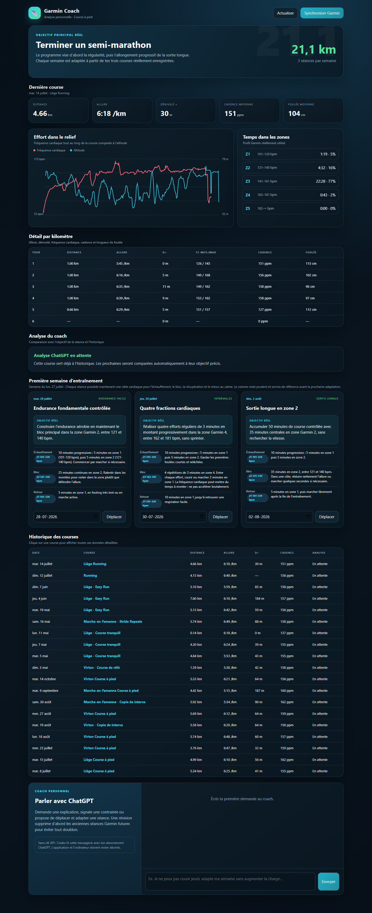

# Motionest

### Tes courses Garmin deviennent un plan d’entraînement qui évolue avec toi.

Motionest est une application locale pour les coureurs qui veulent comprendre leurs séances et savoir quoi courir ensuite. Elle rassemble ton historique Garmin, détaille chaque sortie, fait analyser tes données par un coach IA et prépare la semaine suivante directement dans Garmin Connect.



> Un seul tableau de bord pour passer de « voilà ma course » à « voilà ce que je dois faire maintenant ».

## Pourquoi l’utiliser ?

Garmin Connect collecte beaucoup de données. Motionest les transforme en décisions utiles :

- **Comprendre chaque sortie** : allure, fréquence cardiaque, dénivelé, cadence, foulée et détail kilomètre par kilomètre.
- **Recevoir un retour concret** : le coach compare la séance réalisée à l’objectif prévu et à l’historique récent.
- **Suivre un vrai objectif** : 5 km, semi-marathon ou autre distance, avec date cible et fréquence d’entraînement personnalisables.
- **Savoir quoi courir ensuite** : la semaine suivante est structurée en échauffement, bloc principal, zones cardio et récupération.
- **Retrouver ses séances sur Garmin** : les entraînements sont créés puis programmés dans le calendrier Garmin Connect.
- **Adapter la semaine sans perdre le fil** : reporte une séance ou indique qu’elle n’a pas été faite ; le plan garde un état fidèle à la réalité.
- **Échanger avec son coach** : demande une adaptation en langage naturel depuis le tableau de bord.

## Comment ça marche ?

```text
Montre Garmin → Garmin Connect → Synchronisation locale → Analyse IA
                                                        ↓
Tableau de bord ← Entraînements Garmin ← Nouveau plan hebdomadaire
```

L’application fonctionne sur ton ordinateur et s’ouvre dans le navigateur. Le bouton **Actualiser et analyser** importe les nouvelles courses à la demande : aucune synchronisation cachée ne démarre au lancement.

## Démarrage rapide sous Windows

### 1. Installer

Prérequis : **Python 3.11 ou plus récent** et Windows 10/11. Le compte Motionest
est distinct de Garmin ; un compte Garmin Connect est facultatif pour découvrir
l'application sans historique.

```powershell
git clone https://github.com/VictorRenkin/garmin-coach.git
cd garmin-coach
python -m venv .venv
.venv\Scripts\python.exe -m pip install -r requirements.txt
```

### 2. Connecter Garmin (facultatif)

Pour commencer sans Garmin, passe directement à l'étape 3, crée ton compte
Motionest et choisis le parcours de découverte après avoir renseigné ton profil.
Tu pourras connecter Garmin ensuite depuis ce parcours sans perdre tes déclarations
ni ta conversation. Aucune activité de démonstration n'est ajoutée à ton compte.

Pour une connexion Garmin depuis la ligne de commande :

```powershell
.\connexion-garmin.cmd
```

L’adresse, le mot de passe et l’éventuel code de vérification sont demandés de manière interactive. Le mot de passe n’a pas besoin d’être enregistré. Les jetons de session restent dans `.secrets/garmin_tokens/`, hors de Git.

### 3. Ouvrir l’application

```powershell
.\ouvrir-dashboard.cmd
```

Le navigateur s'ouvre sur [http://127.0.0.1:8765](http://127.0.0.1:8765).
Sans Garmin, le dashboard présente ton profil et un historique vide. Avec Garmin
connecté, le bouton **Actualiser et analyser** permet d'importer tes activités.

L'import et les actions Garmin demandent une connexion Garmin explicite, mais
pas de clé IA. Le coach conversationnel nécessite un fournisseur IA configuré.

## Ce qui fonctionne selon ta configuration

| Fonction | Sans clé API | Avec une API compatible |
| --- | :---: | :---: |
| Importer et consulter les courses Garmin | ✓ | ✓ |
| Afficher les graphiques, zones et tours | ✓ | ✓ |
| Gérer l’objectif et reporter une séance | ✓ | ✓ |
| Discuter avec le coach dans le tableau de bord | — | ✓ |
| Demander une adaptation en langage naturel | — | ✓ |

Sans API, tu peux garder ce projet ouvert dans la même tâche Codex. Le bouton **Actualiser et analyser** importe la dernière course et dépose une seule demande pour Codex ; l’analyse validée revient ensuite dans la même page du tableau de bord. Une clé API sert au chat direct, aux analyses automatiques et aux plans. Codex reste disponible séparément et n’est jamais désactivé par le choix du fournisseur.

### Activer le coach avec le fournisseur de ton choix

Depuis le tableau de bord, choisis OpenAI, NVIDIA NIM, Groq, OpenRouter, GitHub Models, Gemini ou une autre API compatible OpenAI. Tu peux aussi lancer :

```powershell
.\configurer-ia.cmd
```

La clé, le modèle et l’URL sont stockés dans le fichier local `.env`, ignoré par Git. Ne publie jamais ce fichier. Le fournisseur peut être changé sans modifier le code et le pont Codex continue de fonctionner.

## Ce que tu retrouves dans le tableau de bord

| Espace | Ce qu’il apporte |
| --- | --- |
| Objectif | Distance cible, date de course, fréquence hebdomadaire et progression |
| Dernière sortie | Distance, allure, dénivelé, cadence et longueur de foulée |
| Courbes | Évolution de l’allure, du cardio et des zones d’effort |
| Détail par kilomètre | Tours, FC moyenne/maximale, cadence, foulée et dénivelé |
| Analyse du coach | Verdict, points forts, points de vigilance et prochaine priorité |
| Plan de la semaine | Séances structurées, zones cardio, statut et report de date |
| Historique | Toutes les courses importées, avec accès à l’activité Garmin |
| Conversation | Questions de ressenti, conseils et adaptations à confirmer dans le même fil |

## Comptes Motionest

La création d'un compte Motionest est distincte de Garmin et Strava. Elle exige
un mot de passe confirmé, l'acceptation des conditions, une vérification
anti-robot et la confirmation de l'adresse e-mail. Les mots de passe sont
dérivés avec `scrypt` et un sel propre à chaque compte.

En développement, les e-mails de confirmation et de récupération sont déposés
dans `data/outbox/` et le lien est affiché par l'interface locale. Pour la
production, configure `MOTIONEST_ENV=production`, `MOTIONEST_PUBLIC_URL`, les
variables `SMTP_*` ainsi que `TURNSTILE_SITE_KEY` et `TURNSTILE_SECRET_KEY`.
Turnstile n'est demandé qu'à la création du compte. Sans clés valides en
production, l'inscription échoue de manière sécurisée.

Pour tester tout le parcours local sans anti-robot ni confirmation par e-mail,
suis les commandes de [README_LOCAL.md](README_LOCAL.md). Ce mode conserve la
création de compte, l'unicité de l'adresse et la reprise de l'étape réelle du
parcours utilisateur.

## Tes données restent sous ton contrôle

- Les identifiants, jetons Garmin, activités, analyses et rapports sont exclus du dépôt.
- Le serveur écoute uniquement sur `127.0.0.1` par défaut : le tableau de bord n’est pas exposé au réseau local.
- Le coach IA reçoit uniquement le contexte sportif nécessaire pour fournir une réponse personnalisée.
- Une proposition du coach ne modifie l’objectif ou Garmin qu’après confirmation dans le chat.
- Rien ne remplace l’avis d’un professionnel de santé : les recommandations sont sportives, pas médicales.

## Commandes utiles

```powershell
# Tester la connexion Garmin
.\.venv\Scripts\python.exe -m garmin_coach.cli login

# Importer les nouvelles courses sans passer par le tableau de bord
.\.venv\Scripts\python.exe -m garmin_coach.cli sync

# Lancer le tableau de bord sans ouvrir automatiquement le navigateur
.\.venv\Scripts\python.exe -m garmin_coach.dashboard --no-browser
```

## Limites actuelles

### Utiliser ses activités Strava sans envoi vers une montre

Télécharge ton archive personnelle depuis Strava, puis glisse le fichier ZIP sur
`importer-strava.cmd`. Tu peux aussi utiliser les commandes suivantes :

```powershell
.\.venv\Scripts\python.exe -m garmin_coach.cli import-strava "C:\chemin\export_strava.zip"
.\.venv\Scripts\python.exe -m garmin_coach.cli analyze --all
.\.venv\Scripts\python.exe -m garmin_coach.cli weekly --local
```

Les courses rejoignent le même historique et le plan reste visible localement.
L'import passe par l'export appartenant à l'utilisateur, pas par l'API Strava, et
aucune séance n'est envoyée vers une montre.

- Le projet cible aujourd’hui Windows et la course à pied.
- La montre doit avoir synchronisé l’activité avec Garmin Connect avant l’import.
- L’intégration s’appuie sur une interface Garmin Connect non officielle et peut nécessiter une adaptation si Garmin la modifie.
- L'application dispose de comptes Motionest et d'espaces locaux isolés par utilisateur.
  Son lancement par défaut reste local ; les tests locaux ne valident pas à eux
  seuls un hébergement public, la délivrance des e-mails ou la compatibilité Garmin réelle.

---

**Branche ta Garmin. Lance le dashboard. Transforme ta prochaine course en prochaine étape.**
